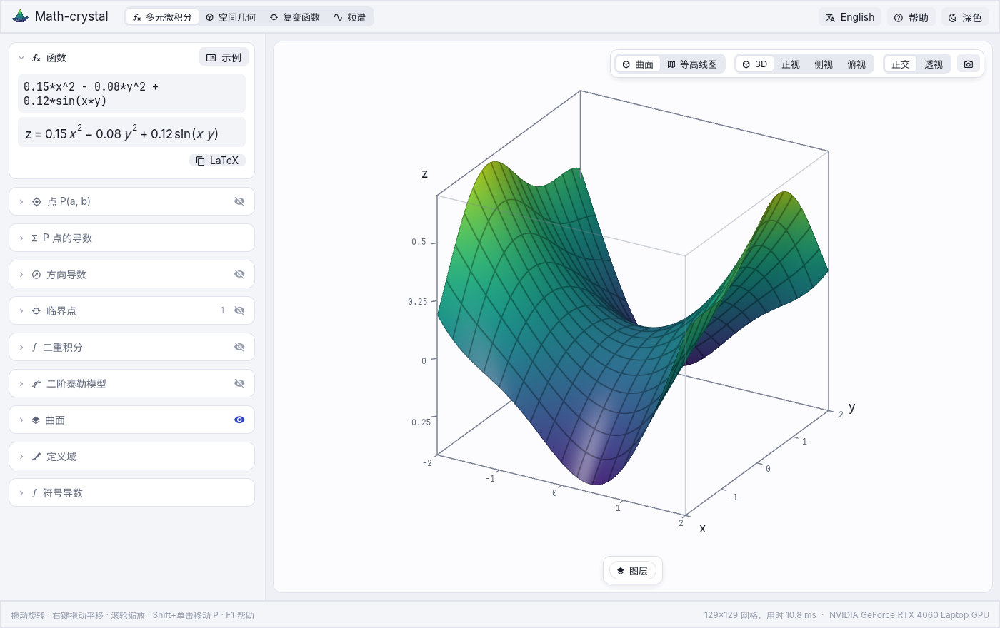
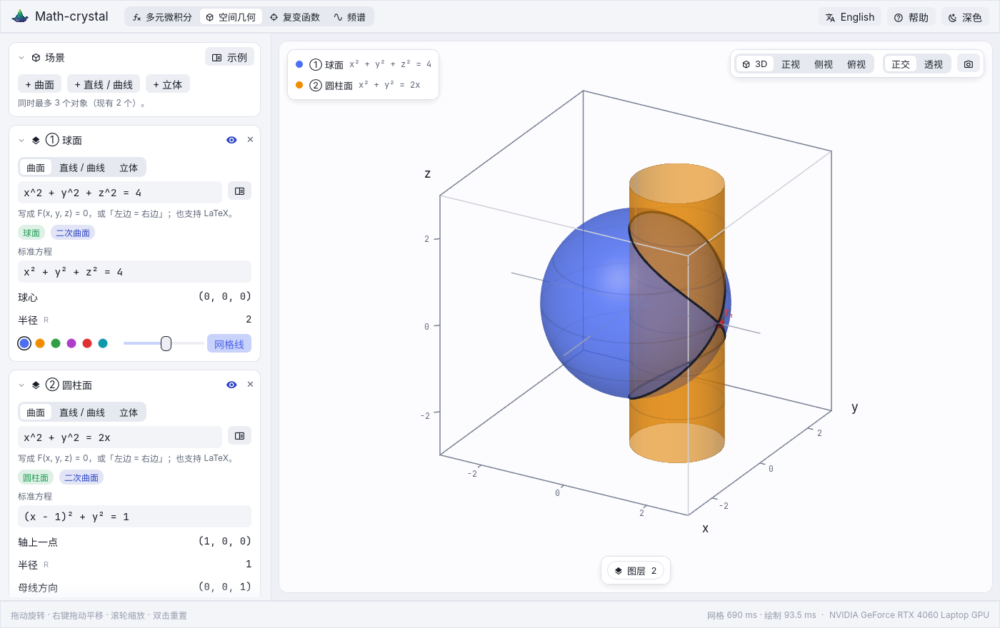
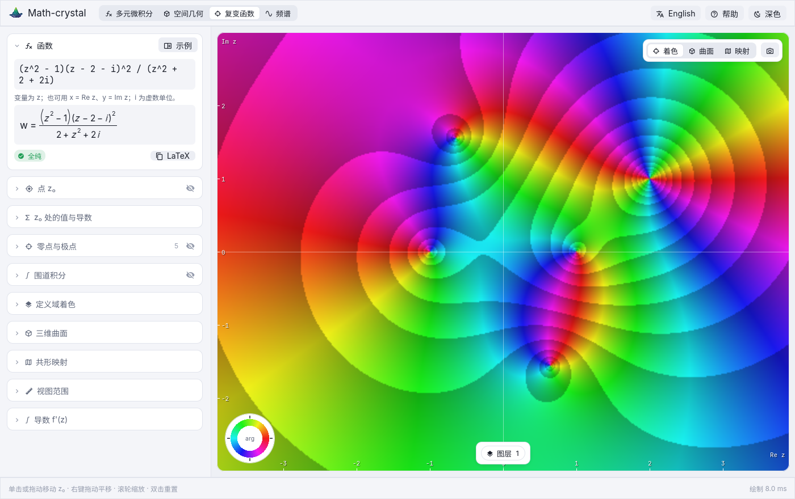
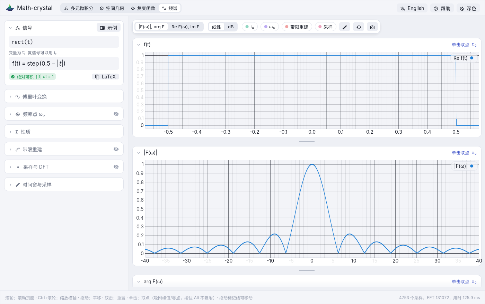

# Math-crystal

可视化数学工作台：多元微积分、空间几何、复变函数、傅里叶频谱。Rust + egui + wgpu 编写，单个可执行文件，界面支持中文 / English。

*A visual math workbench for multivariable calculus, space geometry, complex functions and Fourier spectra. Written in Rust (egui + wgpu); one self-contained executable; Chinese / English interface. [English below](#english).*



## 功能

- **多元微积分**：输入 z = f(x, y)（普通表达式或 LaTeX），画曲面和等高线图；P 点处的偏导数、梯度、方向导数、二阶泰勒模型；临界点及其分类；任意区域上的二重积分，并可显示黎曼和柱体、累次积分截面。
- **空间几何**：隐式曲面 F(x, y, z) = 0（二次曲面自动识别并给出标准方程）、直线 / 曲线、球、柱、锥、长方体；求交线、交点、切点，投影到坐标平面，用 x / y / z = c 截面查看截面实形。
- **复变函数**：定义域着色、|f| 起伏曲面、映射网格；解析性检验、零点与极点、留数、围道积分。
- **频谱**：给出绝对可积的 f(t)，画出傅里叶频谱、带限重构，演示采样与 DFT。
- 未知的单个字母自动变成参数滑块，可播放动画；视图可导出 PNG（保存在「图片/Math-crystal」）。

| 空间几何 | 复变函数 | 频谱 |
|---|---|---|
|  |  |  |

## 安装

在 [Releases](../../releases) 页面下载：

- **Windows**（10 / 11，64 位）：下载 `math-crystal-<版本>-windows-x86_64.zip`，解压后运行 `math-crystal.exe`。不需要安装，也不需要额外的运行库。程序没有代码签名，第一次运行时 SmartScreen 可能拦截，点「更多信息 → 仍要运行」即可。
- **Arch Linux**：从 AUR 安装 `math-crystal`（从源码编译）或 `math-crystal-bin`（预编译），例如 `paru -S math-crystal-bin`。
- **其他 Linux**：下载 `math-crystal-<版本>-linux-x86_64.tar.gz`，解压后直接运行 `math-crystal`；压缩包里附有 `.desktop` 文件和图标。

需要支持 Vulkan、DirectX 12 或 OpenGL ES 3 的显卡驱动。程序默认使用集成显卡（更省电），设置环境变量 `WGPU_POWER_PREF=high` 可改用独立显卡。

## 从源码编译

需要 Rust 1.85 及以上版本（edition 2024）：

```sh
cargo build --release
./target/release/math-crystal
```

Linux 上编译需要 `libxkbcommon` 和 `wayland` 的开发文件（Arch 已自带；Debian / Ubuntu 需安装 `libxkbcommon-dev libwayland-dev`）。

`cargo test --lib` 运行单元测试；`cargo run --example ui_preview -- <输出目录> [--zh] [--dark] [--space|--complex|--spectrum]` 不打开窗口，直接把整个界面渲染成 PNG。

## 发布新版本（维护者）

1. 修改 `Cargo.toml` 中的 `version`，提交。
2. 打标签并推送，例如 `git tag v0.2.0 && git push origin v0.2.0`。
3. GitHub Actions 会编译 Linux 和 Windows 版本，并自动创建 Release，附带 `SHA256SUMS`。
4. AUR：把 `packaging/arch/*/PKGBUILD` 的 `pkgver` 改为新版本，运行 `updpkgsums` 和 `makepkg --printsrcinfo > .SRCINFO` 后推送到 AUR。

界面里新增中文文字或图标后，请运行 `scripts/build-fonts.py` 重新生成内置字体；`bundled_fonts_cover_source_text` 测试会检查字体是否覆盖了全部字符。

## 许可

代码采用 [MIT](LICENSE) 许可。内置字体及其许可证在 `assets/fonts/`：

- Inter、JetBrains Mono —— SIL OFL 1.1
- DejaVu Sans / Sans Mono —— Bitstream Vera 许可（DejaVu 的改动属公有领域）
- Symbols Nerd Font 的部分图标（Material Design Icons）—— Nerd Fonts，MIT
- Crystal Han Sans —— Adobe 思源黑体（Source Han Sans CN）的子集，SIL OFL 1.1。按照 OFL 对保留字体名「Source」的要求，修改后的字体已改名。

---

## English

**Workspaces**

- **Multivariable calculus** — surfaces and contour maps of z = f(x, y) (plain or LaTeX input); partial derivatives, gradient, directional derivative and second-order Taylor model at a point; critical points with classification; double integrals over regions with Riemann columns and iterated-integral slices.
- **Space geometry** — implicit surfaces F(x, y, z) = 0 (quadrics classified, with standard form), lines and curves, simple solids; intersection curves, points and tangencies; projections onto the coordinate planes; section planes with true-shape views.
- **Complex functions** — domain colouring, |f| relief, mapping grids; holomorphy check, zeros and poles, residues, contour integrals.
- **Spectrum** — Fourier spectrum of an absolutely integrable f(t), band-limited reconstruction, sampling and the DFT.

Unknown single letters become parameter sliders (with play). Views export as PNG to `Pictures/Math-crystal`.

**Install** — from [Releases](../../releases): unzip `math-crystal-<version>-windows-x86_64.zip` and run `math-crystal.exe` (the binary is unsigned, so SmartScreen may ask: *More info → Run anyway*); on Arch install `math-crystal` or `math-crystal-bin` from the AUR; on other Linux distributions unpack the `.tar.gz` and run `math-crystal`. A GPU driver with Vulkan, DirectX 12 or OpenGL ES 3 is required. The integrated GPU is used by default; set `WGPU_POWER_PREF=high` to use the discrete one.

**Build** — Rust 1.85+: `cargo build --release`. On Debian/Ubuntu install `libxkbcommon-dev libwayland-dev` first.

**License** — code under MIT; bundled fonts under their own licenses (see `assets/fonts/` and the list above).
